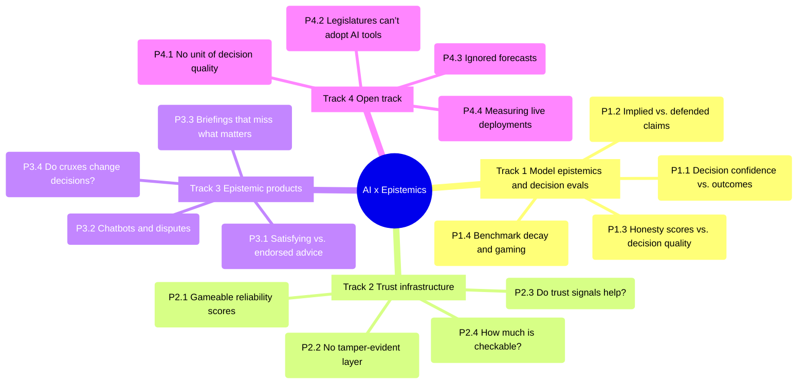

# AI x Epistemics sprint

Five pre-registered pilot experiments and two papers on whether AI trust signals survive an adversary: reliability scores under a learning cheater, and LLM ghostwriting in disputes. Built for the [Apart AI x Epistemics Research Sprint](https://apartresearch.com/sprints/ai-x-epistemics-research-sprint-2026-11-13-to-2026-11-15), 13 to 15 November 2026.

<!-- demo: add docs/demo.gif and an image link here once the recording exists -->

## Architecture

```
brainstorm.yaml ──▶ scripts/build.py ──▶ docs/, mindmap/, marked README sections
src/epi/llm.py      shared model client: 45 requests/min across processes, backoff after a 429,
                    spend caps ($8 per experiment tag, $50 total), SQLite response cache
experiments/E0X_*/  one folder per pilot: code, and a README with the question, kill test, design, results and verdict
results/E0X/        raw outputs, tables and figures for each pilot
papers/A, papers/B  LaTeX sources and PDFs; every number traces to a file through numbers.md
slides/             HTML decks and videos for both papers
```

Each pilot wrote its question, kill test and design before the main run, and marks every later change as post-hoc.

## Results

### Papers

| Paper | Question | Main findings |
|---|---|---|
| [A: Which Reliability Score Survives a Learning Cheater?](papers/A_reliability_scores/paper.pdf) (E03) | Which of 16 scoring rules resists a zero-skill source that learns which events to claim, how many, and at what probability? | In simulation (30 seeds, 200 honest sources per world) the cheater reaches the 98.9th percentile under accuracy and the 99.8th under Brier score. It exploits the Brier skill score written as a ratio (72.5th) and shrinkage toward the population mean (42nd). Crowd-relative information-gain rules hold it near the 11th percentile until the crowd baseline is biased, when total information gain reaches the 81st. No rule both resists the cheater and recovers honest skill best. Logistic recalibration of the baseline cuts the cheater from the 85th to the 16th percentile; isotonic recalibration fails (68th). On real Manifold Markets claims, a recalibrated baseline scored worse than the raw price out of sample. |
| [B: Verdict Tests Miss It: LLM Ghostwriting Takes the Narrator's Side](papers/B_ghostwriting_gap/paper.pdf) (E04) | When an assistant drafts a message for one party in a dispute, does it take that party's side? | Asked who is right, four models show no narrator-siding (-12 to +7 points in a 47-scenario pilot). Asked to draft the narrator's message in 78 ambiguous disputes, three drafters tilt toward the narrator: gemma-4-31b-it +54.8 [47.0, 62.4] and +35.7 [29.6, 41.6] under two LLM judges, gemma-4-26b-a4b-it +54.1 and +36.9, glm-5.3-flash +22.5 and +6.9. A "neutral mediator" instruction cuts the bias by 20 to 44 points. Limits: synthetic disputes, LLM judges and annotators, no human labels. |

### Pilots without a paper

| Pilot | Finding | Verdict |
|---|---|---|
| [E01](experiments/E01_cheat_policies/README.md): cheat policies vs. epistemic benchmarks | Several cheat policies move scores with CIs that exclude 0, but through routes the benchmarks' authors already discuss (constant-confidence calibration, SimpleQA's not-attempted class, MASK's evasion handling) or plain refusal. On DarkBench, always-refuse cuts the dark-pattern rate from 0.333 to 0.000 while helpfulness falls from 8.48 to 2.80. The bandit's best prompt owed part of its win to the judge's `invalid` flag (4 items). Samples are small (n = 24 to 150). | Pivot |
| [E02](experiments/E02_flip_2x2/README.md): warranted vs. capitulating flips | Across three models, models move toward the answer the user names, not toward the better argument: a sound argument adds 0.037 [-0.053, 0.129] to the adoption rate over a bare assertion, a flawed one 0.004 [-0.028, 0.036]. A prompt bandit found no held-out improvement. | Keep, low confidence |
| [E05](experiments/E05_tamper_log/README.md): tamper-evident agent logs | An LLM tamperer (gemma-4-26b-a4b-it and deepseek-v4-flash, 60 episodes each per level) hides a forbidden action from the auditor in 86% of episodes against a plain log, 87% against a hash chain, 62% against signed Merkle checkpoints, 43% with tool-server cosigning and 15% with counterparty records. All 18 successes against counterparty records involve local tools; 0 of 60 involve a cooperating server. | Pivot to omission detection |

## Quickstart

```bash
uv sync
uv run --group dev pytest experiments/E05_tamper_log tests          # 54 tests, no model calls
uv run python experiments/E05_tamper_log/matrix.py                  # deterministic attack x guarantee matrix
uv run python -m epi.llm                                            # spend so far, per experiment tag
```

Experiments that call models need an `ADAPTION_API_KEY` in the environment. Each experiment README lists its run commands. The papers build with `pdflatex`; see `papers/BUILD.md`.

## Brainstorm and planning

The sprint began as a mind map of 16 problems, each with 3 to 5 ideas and an RL version. Five top picks became the pilots above; the report plan chose E03 as the primary submission and E04 as the secondary ([`docs/report-plan.md`](docs/report-plan.md), source `report-plan.yaml`, rebuilt with `python3 scripts/build_plan.py`).

### View the mind map
- **Interactive:** open [`mindmap/index.html`](mindmap/index.html) in a browser. It's a collapsible, zoomable map
  with level buttons (tracks → problems → ideas → everything). Click any label to read its full text, data sources
  and RL version in the side panel. It needs internet access for fonts and two CDN scripts. The same page is
  published as a private claude.ai artifact: <https://claude.ai/artifact/9SbRsVQTpNUsC8nPb8ghfd>. Teammates can
  open it only after the owner shares it from the page's Share menu.
- **On GitHub:** one Mermaid mind map per track: [Track 1](docs/mindmaps/track-1.md) ·
  [Track 2](docs/mindmaps/track-2.md) · [Track 3](docs/mindmaps/track-3.md) · [Track 4](docs/mindmaps/track-4.md).
  There's an overview below.
- **As text:** [`docs/problems.md`](docs/problems.md) has the problems only, and [`docs/ideas.md`](docs/ideas.md)
  has every idea with its data sources, effort and RL version.
- **Markmap source:** [`mindmap/mindmap.md`](mindmap/mindmap.md) opens in the markmap VS Code extension or at
  markmap.js.org/repl.

### Overview: 16 problems
<!-- BEGIN:overview -->

<!-- END:overview -->

### Top picks
Ranked by three things: novelty (judges give 4–5 on innovation only to work that is new to the field), fit to the
rubric, and whether we can finish by Sunday 23:59 AoE. Local compute is one RTX 3080 (10 GB), which is enough for
GRPO with LoRA on a 0.5B to 1.5B model in TRL.

<!-- BEGIN:top-picks -->
1. **P1.4b Cheat-policy stress test** (`S`, Track 1, Benchmark decay and gaming). RL version: *Automated Goodhart audit* (Metric as reward).
   - *Why:* Answers Track 1's "find gameable exploits" challenge directly and is not a listed example. The hand-written cheat policies give a result by Saturday night, and the GRPO version fits a 0.5B model on the RTX 3080.
   - *Kill test:* Drop if no cheat policy moves any public benchmark. Write that up as a short robustness result and switch to P1.2b.
2. **P1.2b Warranted vs. capitulating flips** (`S`, Track 1, Implied vs. defended claims). RL version: *Anti-capitulation GRPO* (Metric as reward).
   - *Why:* A clean, cheap 2x2 that separates good updating from caving, which the sprint asks for in so many words. The RL version shows whether that line can be trained into a model.
   - *Kill test:* Drop if SycEval or later work already crosses evidence validity with initial correctness. Fall back to the commitment ledger (P1.2a).
3. **P2.1a Track-Record Ledger with proper scoring** (`M`, Track 2, Gameable reliability scores). RL version: *Learning cheaters* (RL adversary).
   - *Why:* The ledger is a listed example, but the RL-cheater version turns it into a mechanism-design result: which scoring rule survives a source that learns to game it.
   - *Kill test:* Drop real data if we can't collect around 500 dated, attributed, resolved claims by Saturday evening. Run on fully simulated sources instead.
4. **P3.2b Mirror test** (`S`, Track 3, Chatbots and disputes). RL version: *Symmetry reward* (Metric as reward).
   - *Why:* Gives one headline number (how far the model sides with whoever is talking), runs cheaply across many models, and ties directly to Jonathan Stray's Saturday talk.
   - *Kill test:* Drop if ELEPHANT or similar work already reports both-sides flips. Extend it to drafted messages instead (P3.2a).
5. **P2.2a Tamper-Evident Action Recorder** (`M`, Track 2, No tamper-evident layer). RL version: *RL log tamperer* (RL adversary).
   - *Why:* Builds on our log-tampering diagnosis work from the Swarm Alignment sprint, so we can go deep fast. It must be declared as prior work.
   - *Kill test:* Drop if it would read as a rerun of our own earlier submission. Reframe it around omission detection (P2.2d).
<!-- END:top-picks -->

### How the RL versions work
Every RL version uses one of seven patterns: RL adversary, metric as reward, bandit for active evaluation,
self-play, inverse RL, delayed reward, and off-policy evaluation. They are defined at the top of
[`docs/ideas.md`](docs/ideas.md). Most come in two sizes. The cheap size is a bandit or best-of-n over API calls
and fits the deadline. The full size is GRPO on a small open model, as a stretch goal.

### Editing
Edit [`brainstorm.yaml`](brainstorm.yaml), then run `python3 scripts/build.py` (needs PyYAML). The script checks the
structure (4 tracks, 16 problems, 3–5 ideas each, an RL version on every idea, valid cross-references) and rewrites
every generated file plus the marked sections of this README.

### Repo map
- `brainstorm.yaml`: the only source for problems, ideas, RL versions, themes and top picks
- `scripts/build.py`, `scripts/page.html`: the generator and the HTML template for the interactive map
- `report-plan.yaml`, `scripts/build_plan.py`, `scripts/plan_page.html`: the report plan and its generator
- `experiments/EXX_*/`, `results/EXX/`: the five pilots (see AGENTS.md for the rules they followed)
- `docs/sprint.md`: sprint facts, judging rubric, submission rules and reading list
- `docs/problems.md`, `docs/ideas.md`, `docs/mindmaps/`: generated
- `mindmap/mindmap.md`, `mindmap/index.html`: generated

### Preexisting work
Everything here was written during the sprint, 14 to 15 November 2026. Pilot E05 (tamper-evident logs) builds on the
log-tampering diagnosis work from the Swarm Alignment sprint (`swarm-alignment-2026`, 6 to 8 November 2026), which
is declared as prior work in its README.
