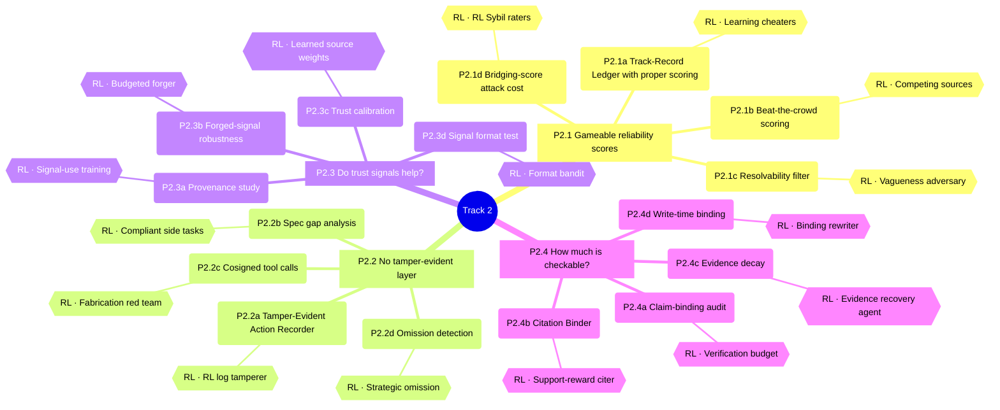

<!-- Generated by scripts/build.py from brainstorm.yaml. Edit the YAML, not this file. -->

# Track 2 · Trust infrastructure

*How do we make checking claims and tracing their origins cheap, routine and hard to manipulate, for people and for AI agents?*

Problems are boxes, ideas are rounded, RL versions are hexagons. Full text is in [docs/ideas.md](../ideas.md). The interactive map is [mindmap/index.html](../../mindmap/index.html).

