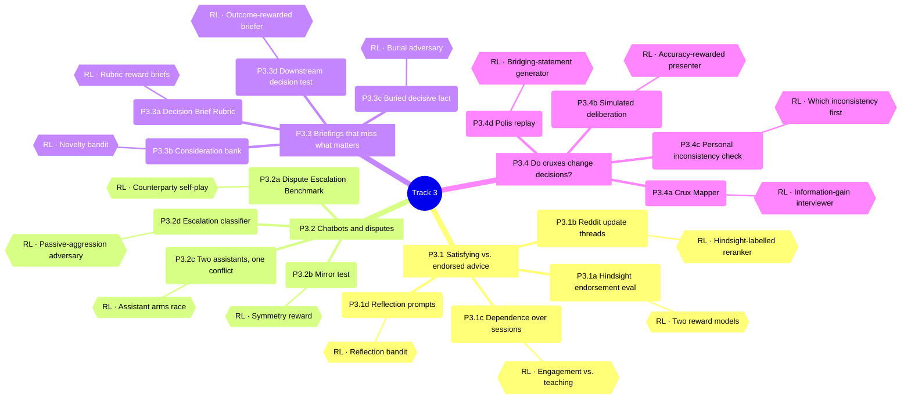

<!-- Generated by scripts/build.py from brainstorm.yaml. Edit the YAML, not this file. -->

# Track 3 · Epistemic products

*Do tools improve the decisions people endorse later, not just how satisfying the advice feels?*

Problems are boxes, ideas are rounded, RL versions are hexagons. Full text is in [docs/ideas.md](../ideas.md). The interactive map is [mindmap/index.html](../../mindmap/index.html).

