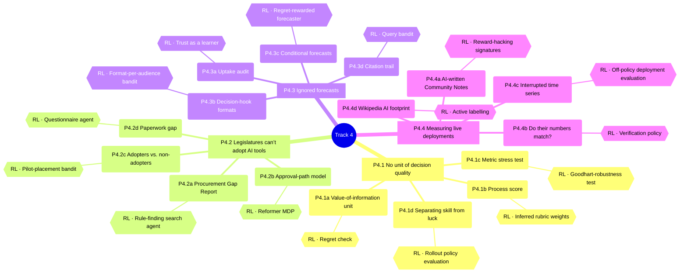

<!-- Generated by scripts/build.py from brainstorm.yaml. Edit the YAML, not this file. -->

# Track 4 · Open track

*What else advances AI for epistemics, including meta-questions about deployment, adoption and impact?*

Problems are boxes, ideas are rounded, RL versions are hexagons. Full text is in [docs/ideas.md](../ideas.md). The interactive map is [mindmap/index.html](../../mindmap/index.html).

