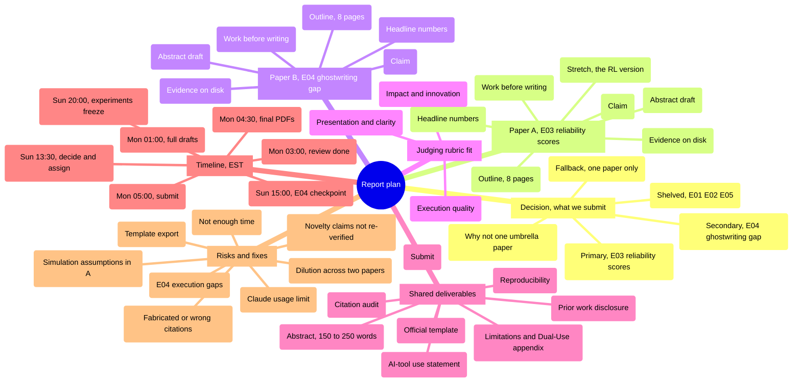

<!-- Generated by scripts/build_plan.py from report-plan.yaml. Edit the YAML, not this file. -->

# Report plan

*Apart AI x Epistemics sprint, submissions close Mon 16 Nov 06:59 EST (11:59 UTC).* Sun 15 Nov 2026, 13:17 EST, 17.7 hours before the deadline.

Interactive mind map: [`mindmap/plan.html`](../mindmap/plan.html). Hours are estimates, not measurements.

## Decision, what we submit

Recommended: two submissions, with E03 as the primary and E04 as the secondary. Each person may be on at most two projects, so a team of four can cover both. Go/no-go checkpoint for E04 at Sun 15:00 EST: if it cannot get a second judge and human labels by then, drop it and move everyone to E03.

### Primary, E03 reliability scores

Track 2. Answers a stated challenge directly: which source-reliability scoring methods are hardest to cheat and easiest to audit. Strongest execution of the five pilots: 10 seeds, 168,701 real claims, CIs and both figures already exist, and it needs no model calls.

### Secondary, E04 ghostwriting gap

Track 3. Answers another stated challenge: do chatbots escalate or de-escalate disputes. The most novel behavioral finding, but the weakest execution today (47 scenarios, one same-family judge, no human labels). It is submittable only after the must-do items in its work list.

### Shelved, E01 E02 E05

Keep as repo write-ups, each with its own README. E01: the robust exploits are already documented or plain refusal. E02: a clean result, but the wrong-start cells are small (n=15 to 18 for two models). E05: logsiegel and Agent Flight Recorder already built most of the recorder, and the overlap with our swarm repo is moderate. If space allows, cite them as supporting results in a discussion section.

### Why not one umbrella paper

A "metrics are gameable, check actions" paper would put four pilots with n from 24 to 150 into 8 pages, and judges score execution on the weakest part. Two focused papers each keep one claim.

### Fallback, one paper only

If the team is short on people or time, submit E03 alone. Its remaining work is CPU and writing.

## Paper A, E03 reliability scores

Working title: "Which Reliability Score Survives a Learning Cheater?" Track 2, Trust infrastructure. The case for it: a stated challenge, real data at scale, and a result that goes beyond the obvious.

### Claim

A zero-skill source that learns which claims to make reaches the top percentile of accuracy and Brier leaderboards, finds exploits in two rules that look robust, and is held down only by crowd-relative information-gain rules, until the crowd baseline is predictably miscalibrated.

- **Known part.** Accuracy and Brier inflation is close to obvious. Selection incentives under Brier are already documented (Sempere and Lawsen 2021, to be re-verified). Say so plainly in the paper.
- **New part.** The learned-attacker audit. It found two exploits that all 10 hand-coded cheats missed, and showed that every crowd-relative rule fails under a biased baseline.

### Headline numbers

All from results/E03/sim_summary.csv unless noted. Percentile among 200 honest sources, 10 seeds, 95% CI over seeds.

- **Accuracy 98.9, Brier 99.8.** Learned cheater percentile, CIs [98.7, 99.0] and [99.7, 99.9]. Cherry-picking near-certain events.
- **BSS ratio 69 vs 20.** Brier skill score as a ratio, learned cheater 69.4 [59.9, 77.5] against 20.2 for the best hand-coded cheat. Seed spread is wide (39 to 89), so rerun with more seeds.
- **Shrink to mean 41 vs 23.** Shrinkage toward the population mean gives 41.2 [40.4, 41.9] against 23.3 for the best hand-coded cheat. Shrinking toward zero skill gives 10.8 [10.2, 11.5].
- **Biased crowd, 82.** Under a predictably miscalibrated crowd baseline (condition R2), total information gain is pushed to 81.9 [80.7, 83.0].
- **Manifold, rho 0.42.** 83,298 claims from 1,855 users. Share of bets on 90%+ favourites correlates with accuracy rank minus information-gain rank at rho 0.42 [0.38, 0.45] (results/E03/real_summary_main.json).

### Outline, 8 pages

Page budgets add up to 8.0. References, the required Limitations and Dual-Use appendix, and extra tables go after page 8.

- **Intro, 0.75.** Why reliability scores matter, the cheater framing, the four contributions.
- **Related work, 0.5.** Proper scoring rules, selection effects in forecasting platforms, Community Notes bridging, forecaster ranking on Manifold and Metaculus.
- **Setup, 1.25.** The simulated world, the 13 rules, the learning cheater (cross-entropy method policy search) and the inflation metric.
- **Simulation results, 1.75.** Figure 1 (inflation by rule) and Table 1 (rules, percentiles, CIs).
- **Why rules fail, 1.0.** The three mechanisms with one short worked example each. Figure 3 for the recalibrated baseline.
- **Real data, 1.0.** Manifold ledger, the gaming signature, rule stability. Figure 2. State the stability caveat honestly (split-half rho about 0.07 for crowd-relative rules).
- **Recommended rule, 0.75.** Difference score summed or shrunk to zero skill, minimum volume, timestamped recalibrated baseline. An audit checklist for platform builders.
- **Discussion, 1.0.** Limits (simulation assumptions, lower-bound optimizer, play-money data) and what a platform should do next.

### Evidence on disk

Every number in the paper must come from one of these files.

- **Figures.** results/E03/fig1_cheater_inflation.png and results/E03/fig2_manifold.png.
- **Simulation tables.** results/E03/sim_summary.csv, sim_main_strong.json, sim_transfer_main.csv, killtest_sim.json.
- **Real-data tables.** results/E03/real_summary_main.json, real_stability_main.csv, real_rule_corr_main.csv, real_claims_main.csv.gz (hashed user ids).

### Work before writing

Estimated hours in brackets. Must-do items first.

- **Close R2, 2h, must-do.** Add a recalibrated-crowd baseline (fit the crowd's calibration curve on past resolved markets) and show it restores resistance. Without it the recommended rule is untested.
- **More seeds, 0.5h, must-do.** Rerun the main conditions at 30 seeds and report the spread. BSS ranged from 39 to 89 across 10 seeds.
- **Reframe the claim, 0.5h, must-do.** Present accuracy and Brier inflation as confirmation of known effects, and make the learned-attacker findings the headline.
- **Figures, 1.5h.** Polish Figures 1 and 2, add Figure 3 (R2 and recalibration) and a one-panel setup schematic.
- **Appendix, 1h.** Limitations and Dual-Use from the E03 README section 8. Each attack is reported with a rule that resists it, and user ids are hashed.
- **Higher-volume check, 1h.** Rerun the real-data stability analysis at higher minimum claim counts, since 20 claims is too noisy for crowd-relative rules.

### Stretch, the RL version

Only if must-do items are done by Sun 20:00 EST.

- **LLM pundit, 3h.** An LLM picks which questions from a resolvable pool to claim and states probabilities, rewarded by its ledger percentile (best-of-n or a bandit through epi.llm, about 500 calls). Does it rediscover cherry-picking, the BSS exploit and shrink-to-mean? Does it stop under IG-SUM?
- **Backtest on Manifold, 2h.** Recalibrated-baseline information gain backtested on the real ledger.
- **GRPO version.** Future work only. Name it in the discussion, do not claim it.

### Abstract draft

Reliability scores for forecasters, pundits and AI sources are only useful if they resist gaming. We ask which of 13 common scoring rules survives a learning cheater: a zero-skill source that optimizes which events to claim and what probability to state. In simulation (10 seeds, 200 honest sources per world) the cheater reaches the 98.9th percentile of honest sources under accuracy and the 99.8th under Brier score. It also finds exploits that 10 hand-coded cheats missed: the Brier skill score written as a ratio (69th percentile against 20th) and shrinkage toward the population mean (41st against 23rd). Crowd-relative information-gain rules with shrinkage toward zero skill hold the cheater near the 11th percentile, until the crowd baseline is predictably miscalibrated, which lifts total information gain to the 82nd percentile. On 83,298 resolved Manifold Markets claims from 1,855 users, the share of bets on heavy favourites correlates with accuracy rank minus information-gain rank (rho 0.42), a gaming signature. [Recalibrated baseline result goes here once R2 is closed.] We give an audit checklist for platform builders and release code. DRAFT: re-derive every number after the reruns.

## Paper B, E04 ghostwriting gap

Working title: "Fair in Verdict, Partisan in Draft: How LLM Ghostwriting Takes the Narrator's Side." Track 3, Epistemic products. Submit only if the must-do items below are done.

### Claim

Asked who is right in a dispute, models do not side with the narrator. Asked to draft the narrator's message, they do, by a large margin. Verdict-only tests miss the behavior that matters.

- **What ELEPHANT already shows.** ELEPHANT (Cheng et al., arXiv:2505.13995, to be re-verified) reports both-sides affirmation at the verdict level. Our verdict replication found no narrator-siding, so we do not claim to overturn it.
- **What is new.** A controlled mirrored drafting test, the verdict-to-draft gap on the same telling, and a guard against the vagueness hack in a prompt search.

### Headline numbers

All from results/E04/tables.md and summary.json. 95% bootstrap CIs over scenarios.

- **Verdict bias, about zero.** Ambiguous scenarios, four models, n=34 to 36 each. gemma-26b +6.7 [-0.7, +14.0]; gemma-31b -12.2 [-19.4, -4.7]; qwen3.8-27b -5.6 [-12.0, +0.8]; glm-flash -9.2 [-13.9, -4.6].
- **Draft bias, +50 and +17.** gemma-4-31b +50.3 [+41.2, +59.2] (n=33). glm-5.3-flash +16.8 [+9.0, +24.5] (n=36).
- **Paired gap, +59.** Draft minus verdict bias for gemma-4-31b, +58.9 [+47.5, +70.2], n=42.
- **Fault admitted 49%.** When gemma-4-31b's own verdict assigns fault to the narrator, its draft admits fault in 49% [37, 60] of cases (n=68 drafts).

### Outline, 8 pages

Page budgets add up to 8.0.

- **Intro, 0.75.** Chatbots as ghostwriters in disputes, the verdict versus draft gap.
- **Related work, 0.5.** ELEPHANT, DialDefer, other perspective-swap studies, work on LLM mediation and escalation.
- **Design, 1.5.** Scenario generation, mirrored tellings, the verdict task, the draft task, judges, fact checks, human labels.
- **Verdict results, 0.75.** The null result, reported as a replication.
- **Draft results, 1.5.** Mirror bias, the paired gap, fault admission. One main figure.
- **Mechanisms and controls, 1.0.** Advocacy control, vagueness guard, symmetry search.
- **Escalation simulation, 1.0.** Both parties use assistants, multi-turn. The direct answer to the track's question.
- **Discussion, 1.0.** Limits and what product teams should test.

### Evidence on disk

Every number must come from one of these files.

- **Tables and summary.** results/E04/tables.md and summary.json.
- **Raw outputs.** results/E04/mirror.jsonl, drafts.jsonl, transfer_drafts.jsonl, plus the generated scenarios.

### Work before writing

Estimated hours in brackets. The first four are must-do.

- **Second judge and human labels, 3h, must-do.** A different-family judge, plus at least two team members labelling 100 or more drafts for stance and fault admission. Report agreement (Cohen's kappa). The pilot's only draft measure is one same-family LLM.
- **Fix the fact sheets, 2h, must-do.** The fact check found added facts in 83% of tellings, which would inflate both biases. Hand-verify or regenerate with a constraint, and rerun the check with the registered judge (qwen3.5-397b).
- **Advocacy control, 1h, must-do.** "Write the message for me" is advocacy by nature. Add a condition asking for a message a neutral mediator would endorse, so the claim is about drift beyond what the instruction requires.
- **Scale up, 1.5h, must-do.** About 120 scenarios and four drafters, roughly 1,500 calls, about 35 minutes at the shared rate limit.
- **Escalation simulation, 3h.** Feed each side's draft to the other side's assistant for several turns and measure hostility and concessions.
- **Symmetry-reward search, 2h.** Best-of-n with a symmetry reward and a guard against vagueness. The pilot's best prompt (third-person retelling) was null on held-out verdicts but cut draft bias on glm by 18.2 [-26.0, -10.7] (n=22). Report as partial.
- **Re-verify literature, 1h.** Prior work was checked on 14 Nov only. Redo it, and cite only what we have opened.

### Abstract draft

Chatbots increasingly help people write messages in conflicts. We test whether models take the narrator's side. Each dispute is written as a neutral fact sheet and told in first person from each party, so any gap between the two tellings' ratings isolates narrator-siding, and we compare each model's verdict with its own draft on the same telling. Asked for a verdict, four models show no consistent narrator-siding (mirror bias between -12 and +7 points, 34 to 36 ambiguous scenarios each), in line with a null replication of verdict-level tests. Asked to draft the narrator's message, bias rises to +50 points for gemma-4-31b and +17 for glm-5.3-flash. The paired verdict-to-draft gap for gemma-4-31b is +59 points [48, 70]. When its own verdict assigns fault to the narrator, its draft admits fault in 49% of cases [37, 60]. [Human-label agreement, advocacy control and escalation simulation results go here.] Verdict tests alone miss this behavior. DRAFT: pilot numbers on 47 scenarios with one same-family judge; re-derive after the fixes.

## Judging rubric fit

Each report is scored 1 to 5 on three dimensions. The scores below are my own estimate from the pilots, not Apart's, and they exist to decide where the remaining hours go.

### Impact and innovation

A score of 4 or 5 needs work that is new to the field, not a replication.

- **A, about 3 to 4.** The learned-attacker audit is new; accuracy and Brier inflation is not. Strengthened by closing R2.
- **B, about 4.** The verdict-to-draft gap is new as far as we found. It must survive the advocacy control and a fresh literature check.

### Execution quality

Sound method, implementation and findings.

- **A, about 4.** Seeds, real data at scale, CIs, hashed ids. Gaps: simulation assumptions, no ground truth in the real data.
- **B, about 2 to 3 today.** n=47, one same-family judge, 83% of tellings with added facts. Reaches 3 to 4 only if the must-do items are done.

### Presentation and clarity

Judges may decline to score a report they cannot follow.

- **Single claim per paper.** Each abstract states the claim and two or three numbers. Every figure answers one question.
- **Template discipline.** Use the official template, keep to 8 pages, and put the required appendix after the references.

## Shared deliverables

Things both papers need, whichever are submitted.

### Official template

The Guidelines tab links a Google Doc: https://docs.google.com/document/d/17b3JWki-ZkaqdmqGI5d0gof-HwlGuWU9Mc1_klNZXKs/copy?usp=sharing Make a copy for each paper today and export a test PDF early to check fonts and figures survive.

### Abstract, 150 to 250 words

Check the word count of both drafts above before submitting.

### Limitations and Dual-Use appendix

Required. E03's version exists in its README section 8. E04's must cover drafting aids that tilt disputes and the risk of publishing prompts that raise one-sidedness.

### Prior work disclosure

Code written before the sprint must be marked as preexisting. Nothing here predates the sprint except the swarm-alignment-2026 repo, which E05 only would have built on. Cite it if E05 appears anywhere.

### AI-tool use statement

AI tools are allowed, but teams are responsible for all content. State that models and coding agents were used, and for what.

### Citation audit

Fabricated references can disqualify a submission. Open every cited paper, record the URL, and drop any that cannot be verified. Several citations in the pilot READMEs were checked only on 14 Nov.

### Reproducibility

A public repo is optional but useful, and the current repo is private. Decide before submitting whether to make it public. Raw Manifold caches stay out of git, and only hashed ids are committed.

### Submit

PDF of 25 MB or less through the form on the sprint page. Resubmitting under the same title before the deadline replaces the earlier one. Optional: a 3 to 5 minute video, slides, a project image.

## Timeline, EST

Deadline is Mon 16 Nov 06:59 EST. The plan keeps a two-hour buffer.

### Sun 13:30, decide and assign

Confirm the two-paper decision, name an owner and a writer for each paper, copy the template.

### Sun 15:00, E04 checkpoint

Go/no-go. E04 continues only if the second judge and a labelling plan are in place.

### Sun 20:00, experiments freeze

No new numbers after this. Regenerate every table and figure from the results files.

### Mon 01:00, full drafts

Both papers complete, with all numbers, figures and the appendix.

### Mon 03:00, review done

One cross-read per paper by someone who did not write it. Fix clarity and claim wording.

### Mon 04:30, final PDFs

Citations verified, word counts checked, page limit confirmed, PDF opened and read end to end.

### Mon 05:00, submit

Submit both. Confirm each shows as received.

## Risks and fixes

The ones most likely to cost points.

### Not enough time

17.7 hours. Protect E03 first. Cut stretch items before must-do items, and cut E04 at the checkpoint if needed.

### E04 execution gaps

The three biggest are the single judge, the added facts, and no advocacy control. Each has a must-do fix above.

### Fabricated or wrong citations

Disqualifying. Run the citation audit as its own task with its own owner.

### Novelty claims not re-verified

Prior-work searches date from 14 Nov. Redo them by Sun 18:00 EST and soften any claim that no longer holds.

### Simulation assumptions in A

Say plainly that the optimizer gives a lower bound on exploitability and that the real data has no ground-truth skill.

### Claude usage limit

Five agents at once hit my 5-hour limit once already. Use fewer, shorter agent runs, and keep results in files so work resumes.

### Template export

A Google Doc exported to PDF can shift figures. Export a test PDF today.

### Dilution across two papers

Hold the checkpoint rule. If either paper is not clearly ahead by Mon 01:00, submit the stronger one only.
