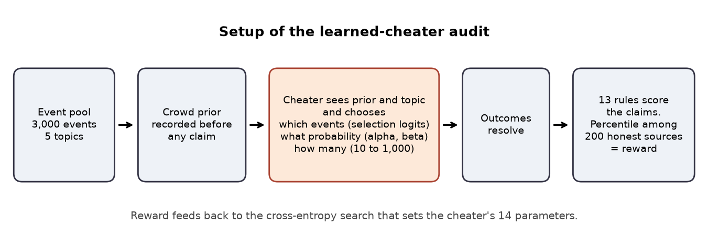
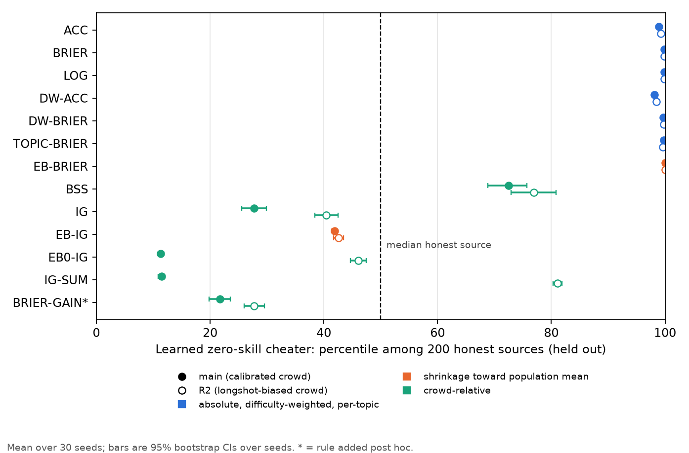
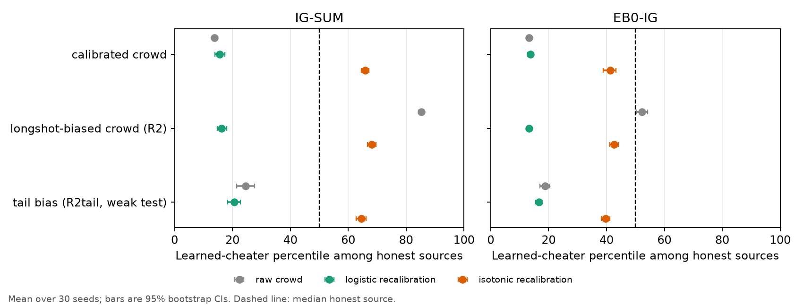
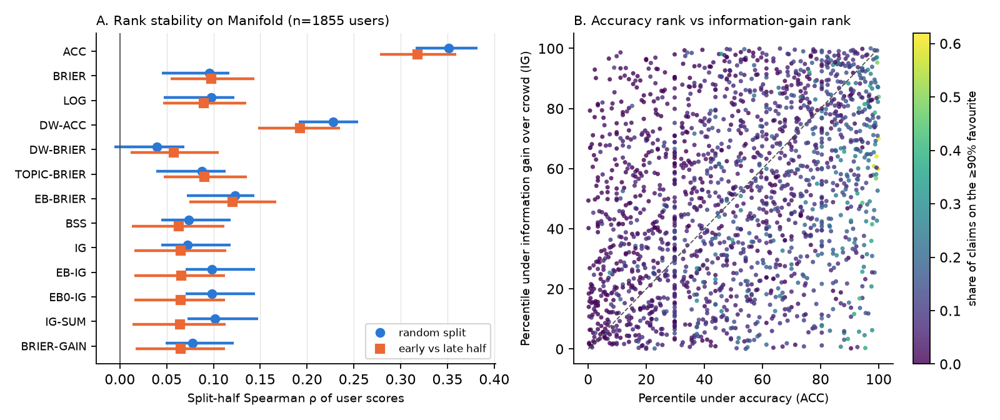

# Which Reliability Score Survives a Learning Cheater?

[AUTHORS: confirm]

Track 2: Trust infrastructure. AI x Epistemics Research Sprint, 13 to 15 November 2026.

## Abstract

Reliability scores for forecasters, pundits and AI sources are only useful if they resist gaming. We ask which of 13 common scoring rules survives a learning cheater: a zero-skill source that optimizes which events to claim, how many to claim and what probability to state. In simulation (30 seeds, 200 honest sources per world) the cheater reaches the 98.9th percentile of honest sources under accuracy and the 99.8th under Brier score, a known selection effect. The new finding is what the learner does to rules that look robust. It exploits the Brier skill score written as a ratio (72.5th percentile, seeds from 39 to 89) and shrinkage toward the population mean (42nd, against 23rd for the best hand-coded cheat). Crowd-relative information-gain rules hold it near the 11th percentile until the crowd baseline is predictably biased, when total information gain rises to the 81st. A logistic recalibration of the baseline restores resistance (16th), but the injected bias is logistic by construction. Isotonic recalibration fails (68th). On real Manifold Markets claims, a recalibrated baseline scored worse than the raw price out of sample. Accuracy rankings reward betting on favourites (rho 0.42), and crowd-relative rules remain too noisy to rank individuals. We give an audit checklist.

<!-- PAGE BUDGET: Introduction, 0.7 pages, about 380 words -->
## 1. Introduction

Platforms rank sources by track record, computed on the claims each source chose to make. A source with no information can still choose which events to claim, how many to claim and what probability to state. If it can learn that choice, how far up the ranking can it climb?

Part of the answer is known. Sempere and Lawsen (2021) show that Brier-scored platforms reward forecasters for picking questions selectively. We confirm that effect and measure its size. We do not claim it as new.

Our contribution is the audit and what it finds. We train a zero-skill cheater against each of 13 rules by policy search and compare it with 10 hand-coded cheats. This addresses a stated challenge of the Trust infrastructure track: which reliability scores are hardest to cheat and easiest to audit.

1. **A learned-attacker audit of 13 rules**, ranked by the percentile a trained zero-skill cheater reaches among 200 honest sources.
2. **Two exploits that hand-coding missed:** the Brier skill score as a ratio, and shrinkage toward the population mean.
3. **Three failure mechanisms:** easy picks, broken zero-skill bounds, and a biased baseline.
4. **A tested, partial fix.** A logistic recalibration of the baseline restores resistance in simulation. An isotonic one does not. On real data recalibration did worse than the raw price.
5. **A real-data check** on Manifold Markets, and a small language-model pundit check.

Limits: the world is simulated, the optimizer gives only a lower bound, the Manifold data uses play money, and the recalibration fix is shown only for a bias that matches the fitted form.

<!-- PAGE BUDGET: Related work, 0.45 pages, about 230 words -->
## 2. Related work

**Proper scoring rules.** A score is proper if honest reporting maximizes the expected score (Gneiting and Raftery, 2007). Properness does not protect against choosing which events to report on. Our crowd-relative rules are differences of proper scores, and Section 5 uses that fact.

**Selection and competition on forecasting platforms.** Sempere and Lawsen (2021) prove that, under Brier scoring, a forecaster should skip some questions even when she knows the true probability. They show that under a total (cumulative) relative Brier score a forecaster should predict the community average rather than abstain. Lichtendahl and Winkler (2007) show that competition pushes reports toward the extremes. Witkowski et al. (2018, 2023) propose a lottery mechanism for winner-take-all prizes.

**Information gain over a crowd.** In a market scoring rule, a trader who moves the market report from an old value to a new one is paid the difference of the two scores (Hanson, 2002). With the logarithmic rule this is our information gain over the crowd.

**What we did not find.** In a brief search we found no prior work that trains an adaptive zero-skill source against a panel of reliability scores and ranks the scores by learned inflation. The search was short. We claim novelty for the audit only.

<!-- PAGE BUDGET: Setup, 1.1 pages, about 600 words including Table 1 -->
## 3. Setup

**The simulated world.** Each world has 3,000 binary events in 5 topics. Base rates run from about 8% to 92%. Each event has a public log-odds component and a private component. Events with a large private variance are hard. The *crowd prior* is the calibrated forecast given the public information. It is recorded before any source claims.

**Honest sources.** Each world has 200 honest sources. Skill k is drawn uniformly from 0.1 to 0.9. A source sees a noisy signal of the private component and reports the calibrated posterior. Volume is log-uniform from 10 to 500 claims.

**Zero-skill sources.** These see only the crowd prior and the topic. We code 10 hand-made cheats, such as cherry-picking near-certain events and flooding with 1,000 claims.

**The learning cheater.** The cheater is a zero-skill policy with 14 parameters: selection logits over 6 crowd-confidence bins and 5 topics, a report map sigmoid(alpha x logit(crowd) + beta), and a volume from 10 to 1,000 claims. We train it separately against each rule with the cross-entropy method, a derivative-free policy search (Rubinstein, 1999). The reward is its percentile among the 200 honest sources.

**Inflation metric.** We report the trained cheater's percentile on 20 fresh test worlds per seed, averaged over seeds, with a 95% bootstrap CI over seeds. The pilot used 10 seeds. The main conditions were rerun at 30 seeds. A percentile of 50 is the median honest source.

**Figure 0. What does the cheater see, what does it choose, and where does the score come from?** Source: schematic.

**Table 1. The 13 rules.** Higher is better for every rule.

| id | rule | family |
|---|---|---|
| ACC | Accuracy | absolute |
| BRIER | Negative mean Brier | absolute |
| LOG | Mean log score in bits | absolute |
| DW-ACC | Accuracy weighted by 4c(1-c), c = crowd prior | difficulty-weighted |
| DW-BRIER | Negative Brier, same weights | difficulty-weighted |
| TOPIC-BRIER | Brier minus the topic's mean Brier | per-topic |
| EB-BRIER | Brier, shrunk toward the population mean | shrinkage |
| BSS | 1 minus (source Brier total / crowd Brier total) | crowd-relative |
| IG | Mean of log score of source minus log score of crowd | crowd-relative |
| EB-IG | IG with shrinkage toward the population mean | crowd-relative |
| EB0-IG | IG with shrinkage toward zero (the zero-skill baseline) | crowd-relative |
| IG-SUM | Total information gain over all claims | crowd-relative |
| BRIER-GAIN* | Mean of Brier(crowd) minus Brier(source) | crowd-relative |

*Added after the first main run showed BSS inflated. It is labelled post hoc.

**Robustness conditions (exploratory, post hoc).** R1: honest sources miscalibrated. R2: favourite-longshot bias in the crowd, c' = sigmoid(0.75 x logit c), which breaks the bound. R3: a minimum of 30 claims. R2tail: a milder bias in the tails (Section 5.1).

<!-- PAGE BUDGET: Simulation results, 1.5 pages, about 620 words including Table 2 and Figure 1 caption -->
## 4. Simulation results

**Claim: a learning cheater tops the accuracy and Brier leaderboards, and two rules that look robust also leak.**

**Figure 1. How far does a trained zero-skill cheater climb, by rule?** Dots are mean held-out percentiles among 200 honest sources over 30 seeds. Bars are 95% bootstrap CIs over seeds. Filled: calibrated crowd (main). Open: longshot-biased crowd (R2). The dashed line is the median honest source. * marks a rule added post hoc. Source: `results/E03/sim_30seeds_summary.csv`.

**Table 2. Learned-cheater percentile by rule, main condition, 30 seeds.** Mean [95% CI over seeds]. The last two columns are from the 10-seed pilot (`sim_30seeds_summary.csv` has no hand-coded columns).

| rule | learned cheater, 30 seeds | seed range | share of test worlds above median | best hand-coded cheat (10 seeds) | copy the crowd (10 seeds) |
|---|---|---|---|---|---|
| ACC | 98.9 [98.8, 99.0] | 97.9 to 99.4 | 1.00 | 99.1 | 32.6 |
| BRIER | 99.8 [99.8, 99.9] | 99.4 to 99.9 | 1.00 | 99.8 | 29.5 |
| BSS | 72.5 [68.9, 75.7] | 39.2 to 89.4 | 0.70 | 20.2 | 13.1 |
| IG | 27.8 [25.6, 29.9] | 16.5 to 40.3 | 0.33 | 17.3 | 12.3 |
| EB-IG | 41.9 [41.4, 42.3] | 38.4 to 44.3 | 0.14 | 23.3 | 8.1 |
| EB0-IG | 11.3 [10.9, 11.8] | 8.7 to 13.5 | 0.00 | 12.3 | 12.3 |
| IG-SUM | 11.5 [10.9, 11.9] | 6.9 to 13.6 | 0.00 | 12.3 | 12.3 |
| BRIER-GAIN* | 21.7 [19.9, 23.5] | 12.3 to 30.2 | 0.20 | 17.3 | 13.1 |

All 13 rules and condition R2: Appendix, Table A1.

**Absolute rules fall to cherry-picking.** The learned cheater reaches the 98.9th percentile under accuracy and the 99.8th under Brier. Plain cherry-picking of near-certain events reaches the same ceiling. Difficulty weighting, per-topic normalization and shrinkage toward the mean do not help: all seven absolute, difficulty-weighted, per-topic and shrunk Brier-family and accuracy rules score 98 or higher. This confirms the known selection effect (Sempere and Lawsen, 2021). The pre-registered signal test passed in the pilot.

**The learner finds what hand-coding missed.**

- *BSS as a ratio: 72.5, against 20.2 for the best hand-coded cheat.* The learned policy makes about 11 claims, all on events where the crowd is at least 95% sure. If every favourite wins, the source's Brier total is far below the crowd's, and the ratio is near 1. One upset costs little. The percentile is roughly the chance that all 11 favourites win. The seed spread is wide: standard deviation 9.8, range 39.2 to 89.4. BSS is the highest-variance rule. Rewriting it as a difference (BRIER-GAIN) gives 21.7.
- *Shrinkage toward the population mean: 41.9, against 23.3.* The learner makes the minimum 10 claims and roughly copies the crowd. Shrinkage hands it about the average source's information gain. Shrinking toward zero instead (EB0-IG) holds it at 11.3.

**Crowd-relative rules hold, in the main condition.** Mean information gain gives 27.8. The learner makes 10 claims on 80 to 95% favourites and extremizes hard. This variance gamble loses in expectation but lands above the median in 33% of test worlds. EB0-IG and IG-SUM resist every attack we ran: no learned or hand-coded policy beats copying the crowd, and the cheater is never above the median in any test world.

**Robustness (10-seed pilot, Table A2).** Five times more search changed no verdict. A 30-claim minimum removes most variance gambles (IG 11.6, EB0-IG 6.7) but not the BSS exploit (44.7). A cheater trained on accuracy scores only 13.3 under IG, so exploits do not transfer to crowd-relative rules.

<!-- PAGE BUDGET: Why rules fail and whether recalibration helps, 1.3 pages, about 800 words including Table 4 and Figure 3 caption -->
## 5. Why rules fail, and whether recalibration helps

**Claim: three mechanisms explain the results. The third can be fixed in simulation, only when the fix matches the bias.**

**Mechanism 1: absolute scores reward easy picks.** A source that copies a crowd prior c has an expected Brier score of c(1-c). Its expected accuracy is max(c, 1-c). Both improve as claimed events get easier. On a 97% event the expected Brier score is 0.03. On a 50% event it is 0.25. Cherry-picking is optimal, and difficulty weights cancel when every claimed event is easy.

**Mechanism 2: ratios and mean-shrinkage break the zero-skill bound.** For a proper score S, let F be what the cheater sees. For any F-measurable choice of whether to claim (z) and what to state (r):

E[z (S(r, y) - S(c, y))] = E[z E[S(r, y) - S(c, y) | F]] <= 0.

Which events, how many and what probability cannot lift the expected IG, BRIER-GAIN or IG-SUM of a zero-skill source above zero. A ratio is not an average of per-claim differences, so BSS escapes the bound. Shrinkage toward the population mean fails differently: a source with little history receives the average source's credit.

**Mechanism 3: the bound needs a calibrated baseline.** In R2 the crowd has a predictable bias. A source with no private information can earn positive information gain by undoing it. The learned IG-SUM cheater floods, with about 990 claims, and sets alpha near the inverse of the injected bias. Every crowd-relative rule moves up (Figure 1, open dots). Total information gain reaches 81.1, EB0-IG 46.1 and IG 40.5. The cheater has information about the crowd's bias, not about the world.

Appendix Table A8 gives the other crowd-relative rules under R2.

### 5.1 Does recalibrating the baseline close the gap?

We tested one fix. Events arrive in four time blocks. Claims use blocks 1 to 3. The baseline for an event in block b is the crowd prior passed through a map fitted only on earlier, already-resolved events. The cheater sees the published crowd, not the baseline, and cannot influence the fit. We tried a two-parameter logistic map and an isotonic (step-function) map. The raw-crowd rows use the same events with no recalibration.

**Table 4. Learned-cheater percentile under recalibrated baselines.** Mean [95% CI over 30 seeds]. R2tail is a weak test (see text). The raw-crowd rows score only the 2,250 eligible events, so they differ slightly from Table A1.

| world | baseline | IG-SUM | EB0-IG | BSS |
|---|---|---|---|---|
| main (calibrated) | raw | 13.8 [12.9, 14.6] | 13.3 [12.7, 13.9] | 72.3 [67.5, 76.7] |
| main (calibrated) | logistic | 15.5 [14.0, 17.3] | 13.7 [12.8, 14.8] | 73.5 [69.2, 77.3] |
| main (calibrated) | isotonic | 65.8 [64.5, 67.1] | 41.2 [38.9, 43.3] | 71.0 [67.2, 74.6] |
| R2 (longshot bias) | raw | 85.2 [84.3, 86.1] | 52.3 [50.3, 54.2] | 79.4 [74.6, 83.7] |
| R2 (longshot bias) | logistic | 16.2 [14.7, 18.0] | 13.3 [12.6, 14.0] | 80.1 [75.7, 84.2] |
| R2 (longshot bias) | isotonic | 68.2 [66.6, 69.7] | 42.6 [41.1, 44.0] | 79.1 [74.8, 83.1] |
| R2tail (weak test) | raw | 24.5 [21.5, 27.7] | 18.7 [17.0, 20.5] | 75.5 [70.1, 80.4] |
| R2tail (weak test) | logistic | 20.6 [18.4, 22.8] | 16.6 [15.6, 17.6] | 78.3 [73.6, 82.4] |
| R2tail (weak test) | isotonic | 64.5 [62.8, 66.2] | 39.7 [38.3, 41.2] | 78.4 [74.1, 82.3] |

**Figure 3. Does recalibration restore resistance to the learning cheater?** Learned-cheater percentile for IG-SUM and EB0-IG under no, logistic and isotonic recalibration of the baseline, in three worlds. Dots are means over 30 seeds. Bars are 95% bootstrap CIs. The dashed line is the median honest source. Source: `results/E03/sim_recal_summary.csv`.

**Logistic recalibration works in the favourable case.** Under R2, IG-SUM falls from 85.2 [84.3, 86.1] to 16.2 [14.7, 18.0], and EB0-IG from 52.3 to 13.3. All 30 seeds are below the median for IG-SUM (worst seed 31.8). The learned policy changes from about 990 claims to about 41, so the flood-and-invert strategy no longer pays. But the injected bias is exactly logistic in log-odds, so the fitted map is well specified. This is the favourable case. Under a calibrated crowd the logistic baseline costs little (IG-SUM 15.5 [14.0, 17.3] against 13.8 [12.9, 14.6]).

**Isotonic recalibration fails, even with no bias.** IG-SUM stays at 68.2 [66.6, 69.7] under R2 and reaches 65.8 [64.5, 67.1] with a calibrated crowd. The step function, fitted on at most 2,250 noisy outcomes, has a mean baseline error of 0.031, against 0.012 for the logistic map. The baseline is then worse than the raw calibrated crowd. A cheater that floods about 980 claims and copies the published crowd earns positive summed information gain. A baseline must be calibrated in expectation. Fitting it is not enough, because estimation noise is exploitable by volume. The recommendation must therefore name the form of recalibration.

**BSS is not fixed.** BSS stays between 71 and 80 under every baseline, and EB-IG between 40 and 42. A ratio stays exploitable whatever the baseline.

**What we did not test.** The R2tail bias barely hurts the raw baseline (IG-SUM 24.5), so it does not stress the logistic map. A stronger misspecified bias was not tested. We ran no separate hand-crafted attack on the fit. The cheater already chooses bins and volume freely, and its best attack against the logistic fit reached 16.2. We do not claim the recalibrated baseline is attack-proof.

<!-- PAGE BUDGET: Real data, 1.0 page, about 560 words including Figure 2 caption -->
## 6. Real data: Manifold Markets

**Claim: on real data, accuracy rankings reward a stable selection habit. Crowd-relative rules are too noisy to rank individuals, and recalibration did not help.**

**Data.** We pulled 698 resolved yes/no markets from the public Manifold API. Each user's first filled buy on a market is one claim. The stated probability is the market price after the bet. The crowd prior is the price before it. This gives 168,701 claims from 28,704 users, dated 28 December 2021 to 12 November 2026. We analyse the 83,298 claims from 1,855 users with at least 20 claims.

**Figure 2. Are real rankings stable, and do they show the gaming signature?** (A) Split-half Spearman correlation of user scores by rule, 95% bootstrap CIs over users (n = 1,855). Blue: random split. Orange: first half against second half in time. (B) Each dot is a user: percentile under accuracy against percentile under information gain. Colour is the share of claims on a favourite at 90% or higher. Source: `results/E03/fig2_manifold.png`.

Rankings agree within the absolute family (BRIER against LOG, rho 0.99) and within the crowd-relative family (IG against IG-SUM, 0.98), but barely across them (BRIER against IG, 0.10).

**Gaming signature.** Across users, the share of claims on a favourite at 90% or higher correlates with accuracy percentile minus information-gain percentile at rho 0.42 [0.38, 0.45]. The top decile by that share has a median accuracy percentile of 86.5 and a median information-gain percentile of 52.9. The signature is not universal: the top accuracy decile has a median information-gain percentile of 69.9, and 25.8% of those users fall below the median. It strengthens with volume: 0.52 [0.47, 0.58] at 50 claims or more and 0.56 [0.39, 0.67] at 100 or more.

**Stability is not validity.** Accuracy is the most stable rule (split-half rho 0.35 random, 0.32 early against late). The average crowd probability of the side a user bets on is stable too (early against late 0.56). It correlates 0.70 with accuracy and -0.06 with information gain. Accuracy ranks a habit of backing favourites.

**Higher volume helps, but not enough.** At 20 claims or more, crowd-relative rules have split-half rho of about 0.07 and cannot rank users. We raised the minimum to 50 claims (488 users) and 100 claims (112 users). Random-split rho for crowd-relative rules rises to 0.16 to 0.21 and then about 0.40, against 0.47 and 0.67 for accuracy. Early-against-late rho is lower, which is the test that matters for prediction (Appendix Table A3). At 100 claims it is 0.15 to 0.23 for crowd-relative rules, and several CIs reach 0. These are heavy users, a selected subset. We do not claim that crowd-relative rules can rank individuals on this data.

**The recalibrated baseline did worse on real data.** We scored claims in blocks 1 to 3 (126,526 claims) against a baseline recalibrated on earlier blocks. Out of sample, the recalibrated baseline had a mean log2 score of -0.832 (logistic) against -0.790 for the raw price. The fitted logistic slope and intercept drift across blocks, from 0.93 and -0.07 to 0.86 and -0.37. The crowd's bias is not stationary. Rank stability did not improve (IG early against late 0.064 raw, 0.011 logistic). The simulated fix assumes a stationary bias. We make no claim that recalibration improves real leaderboards.

**Caveats.** Play money. A bet is not a stated belief, so information gain measures market impact. The sample favours popular markets. There is no ground-truth skill, so the data show stability and signatures, not which rule is right. The favourite share is a correlational signature, not proof of intent.

<!-- PAGE BUDGET: LLM pundit check, 0.3 pages, about 200 words -->
## 7. A small check with a language-model pundit

**A language model told the rule rediscovers cherry-picking, and nothing more. This is a small supporting check, not a result.**

A model sees 300 simulated events (topic and crowd probability, no outcomes), is told the rule, and may claim 10 to 60 events. It draws 4 strategies, sees its best, draws 4 more, and the winner is scored on an unseen world. We ran two models (gemma-4-31b-it and gemma-4-26b-a4b-it), two world pairs each, 223 calls in total. A third model was dropped because its reasoning used the whole token limit.

Under accuracy and Brier the pundit finds cherry-picking, with held-out percentiles of 98.8 and 99.0. Under IG, IG-SUM and BSS it stays below the median in every run (0.7, 5.2 and 13.8; Table A7). It does not find the BSS exploit that the cross-entropy cheater found. That is consistent with the optimizer being the stronger attacker. A failure to find an exploit is not evidence that none exists. There are 3 to 4 held-out runs per rule, one model family and a small claim pool.

<!-- PAGE BUDGET: Recommended rule, 0.65 pages, about 380 words -->
## 8. Recommended rule and audit checklist

**Claim: a summed crowd-relative difference score with a well-specified baseline is the best design we tested, in simulation and for a stationary bias.**

1. **Use a difference of proper scores against a baseline. Never use a ratio.** BSS gave 72.5 and stays at 71 to 80 under every baseline. Its difference form gave 21.7. We do not recommend BSS.
2. **Aggregate by sum, or shrink toward zero skill. Never shrink toward the population mean.** IG-SUM and EB0-IG gave 11.5 and 11.3. EB-IG gave 41.9.
3. **Set a minimum volume.** A 30-claim floor cut IG from 27.3 to 11.6 in the pilot.
4. **Time-stamp the baseline before the claim.** The bound needs a pre-claim baseline.
5. **If the crowd baseline may be biased, recalibrate it with a low-variance parametric map, such as a two-parameter logistic fit on past resolved events. Do not use isotonic regression.** Logistic recalibration cut IG-SUM from 85.2 to 16.2 under a logistic bias. Isotonic recalibration left it at 68.2.
6. **Test the recalibration out of sample on your own data before adopting it.** On Manifold the recalibrated baseline was worse than the raw price. If the bias drifts, a past-fitted map can hurt.

**Audit checklist for platform builders.**

- Is the score an average of per-claim differences of a proper score? A ratio is an exploit.
- What does a source with no history receive? If the population average, expect low-volume entry.
- Can a source choose which claims enter its score? Then an absolute score is gameable.
- Is the baseline recorded before the claim, and is its calibration checked on resolved questions?
- Has the score been attacked by a learner? Hand-coded cheats under-estimated two exploits here by 19 and 52 percentile points.

<!-- PAGE BUDGET: Discussion, 1.0 page, about 520 words -->
## 9. Discussion

**What is new, and what is not.** Accuracy and Brier inflation through question selection is documented (Sempere and Lawsen, 2021). We confirm it. The new parts are the learned-attacker audit, two exploits that hand-coded cheats missed, the three mechanisms, and the finding that a recalibrated baseline helps only when its form fits the bias.

**Limits.**

- *Simulation assumptions.* Gaussian log-odds world, calibrated honest sources that pick events at random, a cheater that sees only the crowd prior and the topic.
- *The optimizer gives a lower bound.* A rule that resists here has resisted this search budget, not every cheater. BSS ranged from 39.2 to 89.4 across 30 seeds. The language-model check found less than the optimizer did.
- *Recalibration is shown only for a matching bias.* The logistic map fits the injected bias exactly. Our tail-bias test was too mild to stress it, and we ran no hand-crafted attack on the fit.
- *Recalibration did not work on real data.* The Manifold bias drifts across time blocks. The simulated fix assumes it does not.
- *Reward.* We reward expected percentile. A winner-take-all objective would favour variance more.
- *Real data.* Play money, no ground-truth skill, popularity-biased markets. Crowd-relative rules are too noisy to rank individuals, even at 100 claims or more on a temporal split.
- *LLM check.* 3 to 4 held-out runs per rule, one model family.

**Next steps.** A cheater with per-event features. A stronger misspecified bias and a direct attack on the recalibration fit. A baseline that tracks drift. Metaculus data. A GRPO-trained pundit is future work. We do not claim it here.

**Dual use.** The learned policies are recipes for gaming scores. We report each attack beside a rule that resists it, hash user ids and report the signature only in aggregate (appendix).

## References

See `references.md` for the list with URLs.

- Gneiting, T. and Raftery, A. E. (2007). Strictly proper scoring rules, prediction, and estimation. Journal of the American Statistical Association 102(477), 359-378.
- Hanson, R. (2002; published 2007). Logarithmic market scoring rules for modular combinatorial information aggregation. Journal of Prediction Markets 1(1), 3-15.
- Lichtendahl, K. C. and Winkler, R. L. (2007). Probability elicitation, scoring rules, and competition among forecasters. Management Science 53(11), 1745-1755.
- Rubinstein, R. (1999). The cross-entropy method for combinatorial and continuous optimization. Methodology and Computing in Applied Probability 1, 127-190.
- Sempere, N. and Lawsen, A. (2021). Alignment problems with current forecasting platforms. arXiv:2106.11248.
- Witkowski, J., Freeman, R., Vaughan, J. W., Pennock, D. M. and Krause, A. (2018). Incentive-compatible forecasting competitions. AAAI 2018; extended version Management Science 69(3), 2023.
